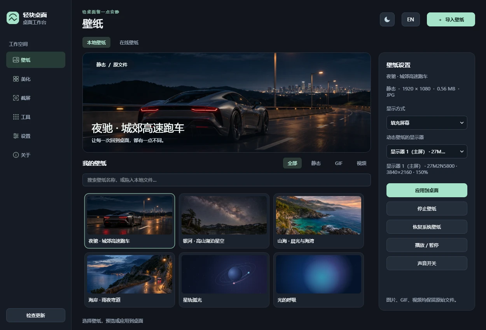
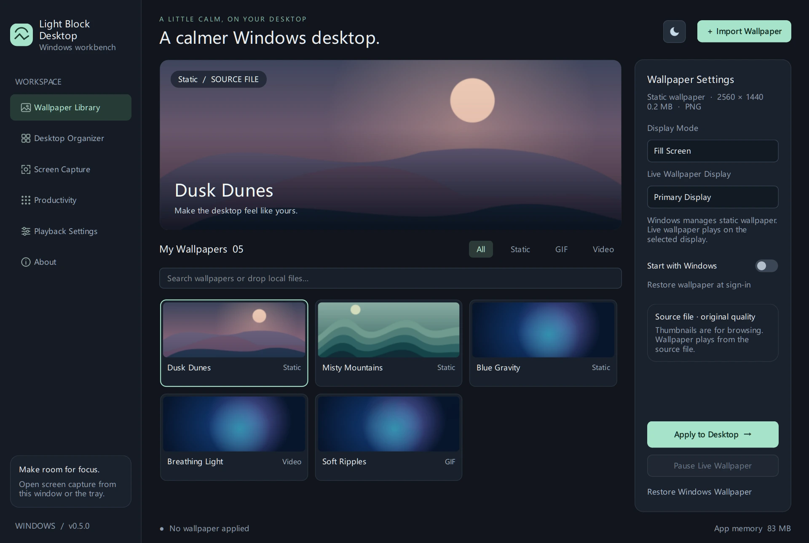
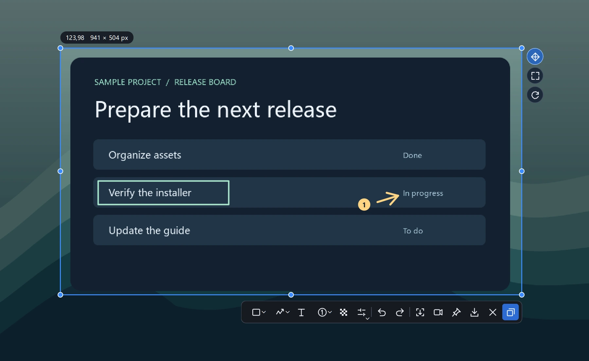
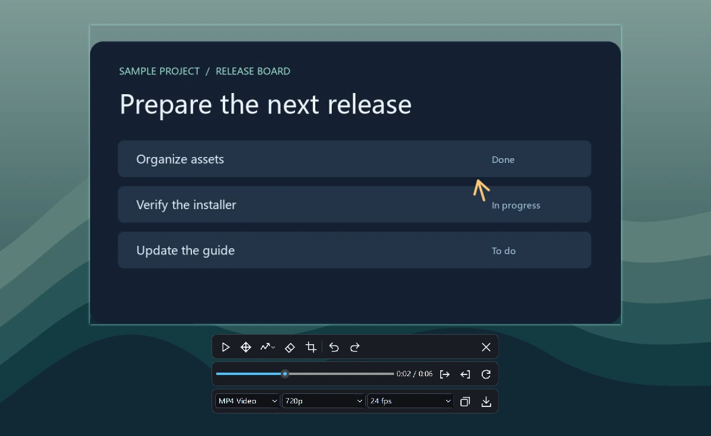
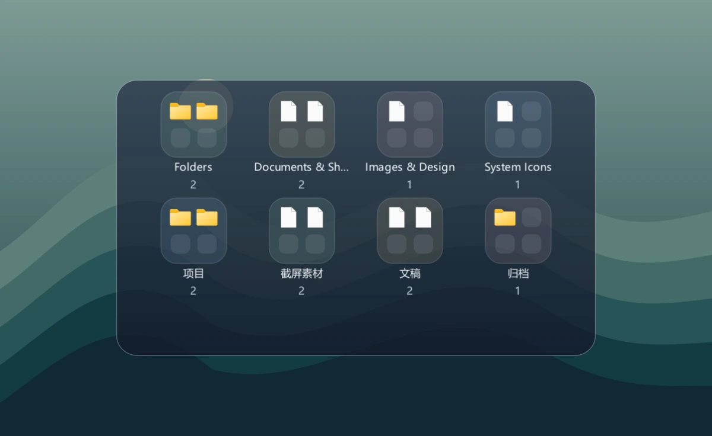
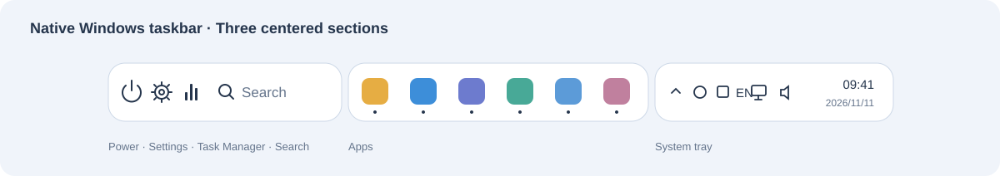
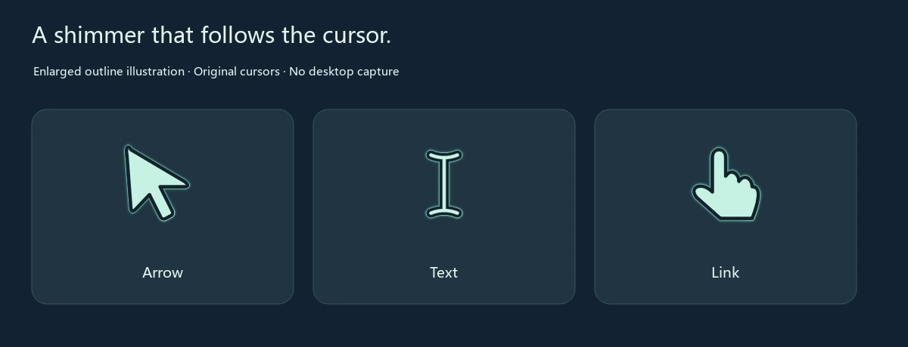
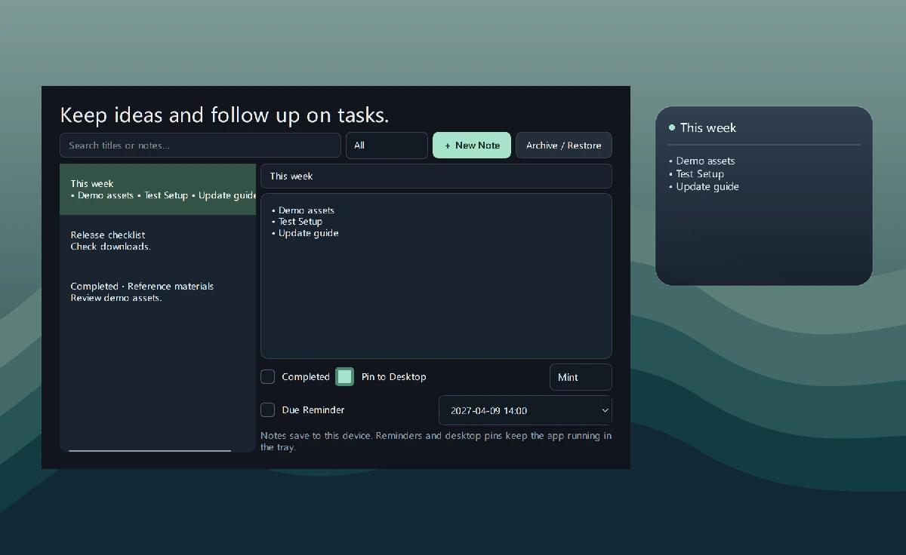
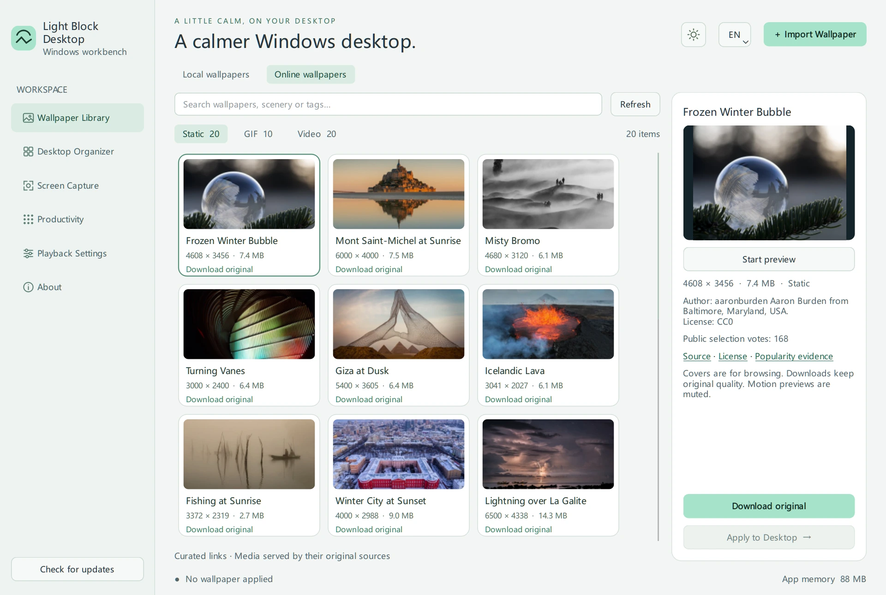

<p align="center"></p>
<h1 align="center">Light Block Desktop</h1>
<p align="center">Live wallpaper, screenshots, screen recording, desktop organization, native taskbar styling and notes for Windows</p>
<p align="center"><a href="https://github.com/GalokPeng/light-block-desktop/releases"><strong>Download latest release</strong></a> · <a href="#feature-preview">Feature preview</a> · <a href="https://light-block-desktop.vercel.app/en/">Website</a> · <a href="README.md">简体中文</a> · <a href="CHANGES.md">Changelog</a></p>


**v2.0.5 stable**: wallpapers, screen capture, recording, desktop styling and notes, with playback and recording components included.

## Download and install

1. Download Setup directly from the [website](https://light-block-desktop.vercel.app/en/) or [GitHub](https://github.com/GalokPeng/light-block-desktop/releases/latest/download/Qingkuai-Setup-x64.exe). Extract the entire portable package before running `轻块桌面.exe`.
2. Windows 10 / 11 x64. Setup follows the system language and includes English, Simplified and Traditional Chinese. Switch Chinese/English and light/dark themes within the app. No separate FFmpeg or virtual audio driver installation is required.
3. Check for updates at the lower left, watch the download progress, then let the verified installer launch after a graceful exit. The installation identity remains compatible. Original v1.0.0 data is retained; migrated data uses `data/profile-v2`, falling back to `%LOCALAPPDATA%/StillWallpaper/profile-v2` for read-only installations. Migration backs up data and commits atomically.

[Download v1.0.0](https://github.com/GalokPeng/light-block-desktop/releases/download/v1.0.0/Qingkuai-Setup-x64.exe). Quit the current version before rollback and prefer a separate installation directory. New changes are not synchronized back to old data. Original source remains on [`python-v1.0.0`](https://github.com/GalokPeng/light-block-desktop/tree/python-v1.0.0).

## Feature preview

The image below shows the actual v2.0.0 interface. Further feature illustrations include earlier-version screenshots and use bundled media or fictional data.



### Wallpaper

Import full-quality copies of local images, GIFs and videos. Choose a display and fit mode, and identify videos by their frame-based covers. Video sound is off by default. Enable it in Settings or the desktop menu after confirmation; the confirmed preference is saved separately, and changing audio reloads the desktop video. Motion decoding runs outside the settings thread. Switching retires the old player and confirms a valid new frame before reporting success. Restore the last wallpaper at sign-in and pause it on full screen.

Right-click an imported wallpaper to delete its library copy while keeping the original. Deleting the active wallpaper first restores Windows wallpaper. The online gallery supports previews, search, original downloads and source attribution. Four bundled 1920×1080 static wallpapers—Night Drive, Milky Way, Mountain Bay and Coastline—replace the previous still images, while existing motion demos remain.



### Screenshots and screen recording

Press `Ctrl+Alt+A` by default to pick a window or region. Annotate, stitch a scrolling region, copy a PNG or pin the capture in place. Choose system audio, microphone, or both before starting; both are off by default. Stop a recording with `Ctrl+Alt+R` to open a pinned preview. Draw, crop and drag the two timeline handles to trim. After selecting a handle, use arrow keys for one source frame, or Shift + arrow keys for ten. Export MP4, GIF or lossless MKV at your chosen quality and frame rate; GIF offers fast and fine palette modes.

| Capture selection and annotation | Recording preview and export |
| --- | --- |
| [](site/public/media/capture-en.webp) | [](site/public/media/recording-en.webp) |

### Desktop organizer and native taskbar styling

Place the organizer at the top, center or bottom. Sort by name, modification time or group, and search for desktop items. New desktop files appear as icons first and are collected after one minute by default. Disable this option for manual collection, or right-click to choose a group. Organizer, taskbar and group options use separate collapsible sections. Color icon plates and the organizer background independently, or reset both to defaults. Group colors stay separate; light panels automatically use dark text. Turning the organizer off restores the original icon visibility.



Optional styling centers power, settings, Task Manager and native search in the first section, apps in the middle and the system tray in the third section on the native taskbar of the primary display on Windows 11 22H2 or later, x64. Windows Search and tray menus stay available. The bar can hide when covered and reappear at the bottom edge. Background color and opacity are adjustable.



*Diagram of the three-section native taskbar*

### Cursors and appearance

Choose Stream, Prism or Pixel in **Appearance → Mouse and Cursors**, with independent color and size settings. Mix any cursor with independently colored Dots, Falling or Glow effects. Glow follows the actual native cursor silhouette without painting over its body. Falling uses fine luminous specks with gentle motion and fades. Effects stop painting when idle; disabling releases the listener, and quitting restores the system scheme.



[View appearance settings](site/public/media/appearance-en-light.webp)

### Desktop notes

Right-click the desktop background to create and pin a note. On Windows 11, start with **Show more options**. Drag the title to move a note, double-click the title to edit, or drag an edge to resize. Scroll long content without visible scrollbars and choose a custom color. Notes & Tasks also provides search, reminders, completion and archiving.



Settings and downloaded wallpapers stay on your device. The online gallery contacts media sources on demand. No account, ads or telemetry. Appearance offers three original silhouettes—Stream, Prism and Pixel—with custom colors and 75%–200% sizing. Mix them with independently colored Dots, Falling or Glow effects, which stop painting when idle. Settings retains the native Windows Night light entry. The app also includes a launcher, clipboard history, a file workbench and focus timers. [User guide](docs/usage.en.md)

v2.0.5 keeps organizer icons and labels opaque while adjusting only the background. Taskbar reveal handles quick edge gestures and minimize transitions, and work-area reconciliation supports maximized or borderless windows that cache the old desktop bounds. Disabling styling restores the original work area and preserves native auto-hide settings.

Update checks no longer reject the official legacy metadata feed. The website supplies the installer size required by existing clients; new clients also use both official domains with bounded timeouts and diagnostic details. Downloads still require SHA-256 verification before closing the app and starting Setup.

The online gallery has 52 images, 20 GIFs and 33 videos, with media-type filters and bilingual search. The maintainer approved retaining the ten GIFs from the local review build. Every source file is at least 1920 × 1080 and no larger than 20 MB, without app-side recompression, trimming or upscaling. GIF candidates must be original 1080p, 16:9 complete looping scenes. GIFs have no likes/favorites threshold; available metrics are recorded as reported. Images and earlier videos retain their public-vote or favorite-based selection. Motion additions use source provenance, dated public page views, visual review and decoded-original verification; unpublished metrics remain null. It supports on-demand previews, byte-preserving downloads, progress/cancellation, downloaded status and Apply. GitHub stores URL and attribution metadata only. Downloads continue when settings close; quitting cancels unfinished downloads. [Evaluation and selection](docs/wallpaper-evaluation.md)



## Development and releases

```powershell
./build.ps1
& ".\dist\LightBlockDesktop\轻块桌面.exe" --data-dir "$PWD\.local\dev-profile"
./tools/test.ps1 -SkipBuild
```

This version uses Windows x64, C++23, Qt Widgets and Win32. Python 3.11 is used only for build, packaging and validation tools; users do not need Python. The complete previous implementation is permanently available on the [`python-v1.0.0`](https://github.com/GalokPeng/light-block-desktop/tree/python-v1.0.0) branch and [`v1.0.0`](https://github.com/GalokPeng/light-block-desktop/tree/v1.0.0) tag. The [development Skill](skills/light-block-desktop-dev/SKILL.md) can onboard an agent. See the [contribution guidelines](CONTRIBUTING.en.md), [release workflow](docs/release.en.md) and [website deployment](docs/website.md).

The application source uses the [MIT license](LICENSE). Bundled dependencies keep their [own licenses](THIRD_PARTY_NOTICES.md).

## Star history

[](https://github.com/GalokPeng/light-block-desktop/stargazers)

[](https://www.star-history.com/#GalokPeng/light-block-desktop&Date)

## Wallpaper sources

[Wikimedia Commons](https://commons.wikimedia.org/) provides the original media and previews used by the online gallery. Works remain copyrighted by their respective authors and follow their individual public licenses. The app and download records retain each author, source and license. [Individual credits](docs/wallpaper-sources.md)

[Internet Archive](https://archive.org/) · [Jeffrey Beach / Beachfront Productions](https://beachfrontprod.blogspot.com/) provide the creator's CC BY 3.0 HD footage, previews and public view/favorite records. The app retains source and attribution.

[NASA Scientific Visualization Studio](https://svs.gsfc.nasa.gov/) supplies aurora, Moon, Earth and black-hole imagery under its [reuse policy](https://svs.gsfc.nasa.gov/help/) and individual credits. New entries have no audio or a verified silent track. NASA does not endorse this application.

[CSU/CIRA Satellite Library](https://satlib.cira.colostate.edu/) · [NOAA](https://www.noaa.gov/) · [JMA](https://www.jma.go.jp/jma/indexe.html) supply the satellite-cloud and Earth imagery used through explicitly licensed Commons originals. Item-specific credits and source marks are retained.

## Thanks and community

[Linux Do](https://linux.do/)
