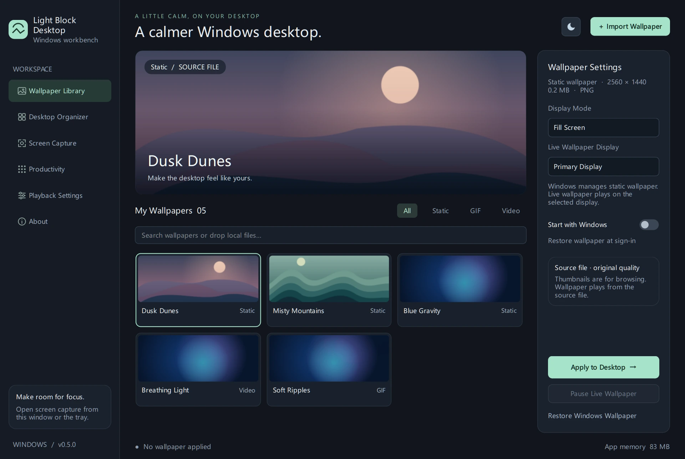
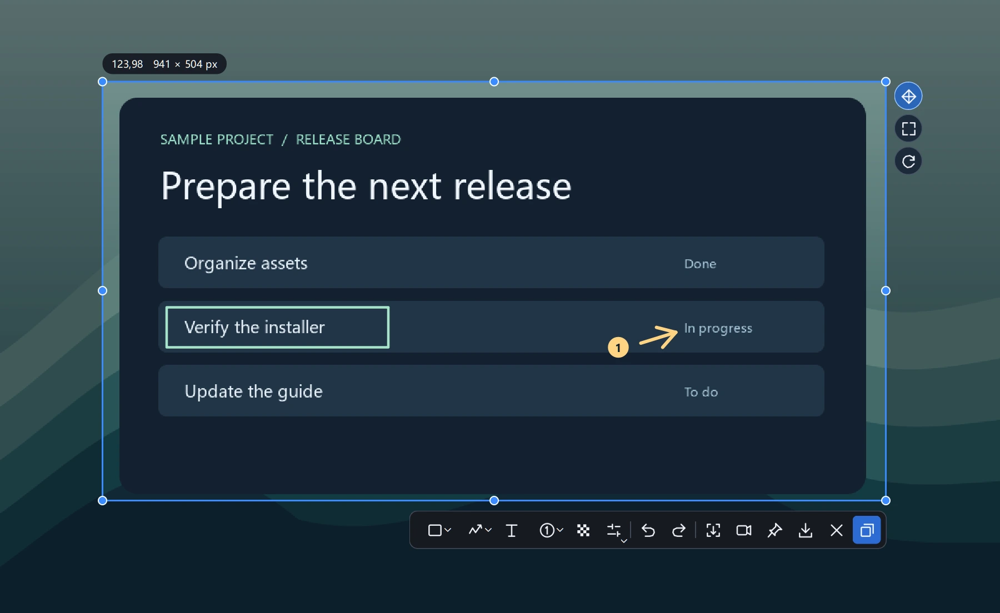
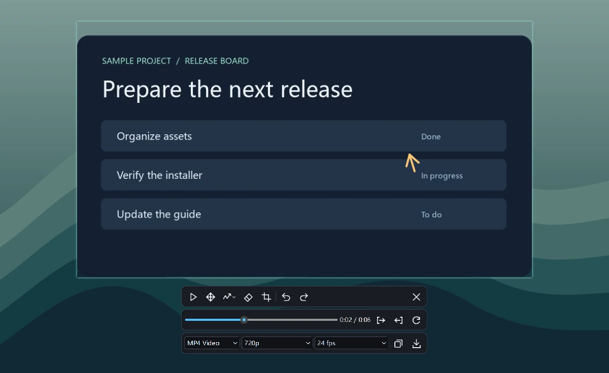
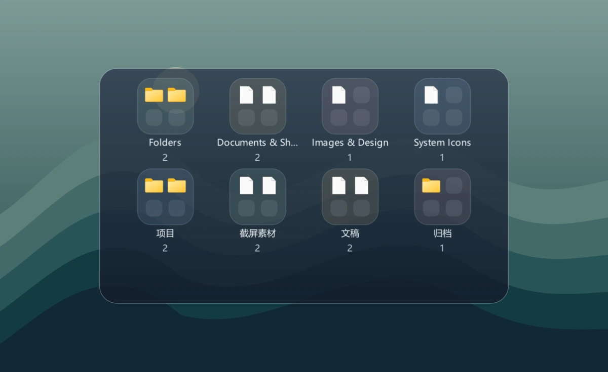
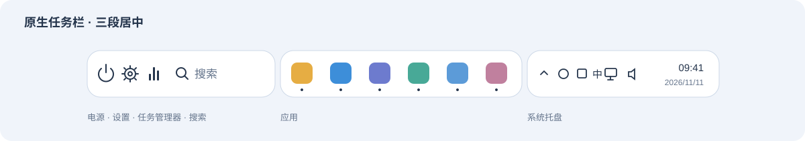
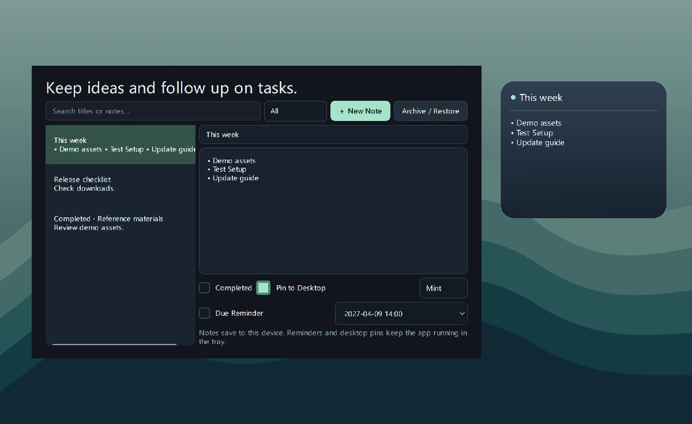

<p align="center"></p>
<h1 align="center">Light Block Desktop</h1>
<p align="center">Live wallpaper, screenshots, screen recording, desktop organization, native taskbar styling and notes for Windows</p>
<p align="center"><a href="https://github.com/GalokPeng/light-block-desktop/releases/latest/download/Qingkuai-Setup-x64.exe"><strong>Download Windows Setup</strong></a> · <a href="#feature-preview">Feature preview</a> · <a href="https://light-block-desktop.vercel.app/en/">Website</a> · <a href="README.md">简体中文</a> · <a href="CHANGES.md">Changelog</a></p>

## Download and install

1. Download `Setup-x64.exe` from [GitHub Releases](https://github.com/GalokPeng/light-block-desktop/releases/latest). For the portable edition, extract the full `Windows-x64.zip` and run `轻块桌面.exe`.
2. Requires Windows 10 or 11 x64. Setup uses the Windows display language and includes English, Simplified Chinese and Traditional Chinese. The app selects Simplified Chinese on Chinese Windows and defaults to English otherwise.
3. Quit the previous version before upgrading. Settings and wallpapers live in `data` beside the app. Existing settings are copied there. If the app folder is read-only, the app uses `%LOCALAPPDATA%\StillWallpaper`.

Setup installs for the current user by default. The installer and portable package include the components needed for wallpaper playback, screen capture, recording and media export. See the [third-party notices](THIRD_PARTY_NOTICES.md) for the recording component's license and source.

Starting with v0.8.0, click **Update now** in the sidebar to download an update with button progress; click again to cancel. After checking the official SHA-256, the app exits normally and starts Setup. Installed copies update in place, preserve settings and restart; portable copies open the installation wizard. Older versions need one manual installation to obtain the updater. The website offers official and public mirror sources to switch when a download is slow.

## Feature preview

### Wallpaper

Import full-quality copies of local images, GIFs and videos. Choose a display and fit mode, and identify videos by their frame-based covers. Video wallpapers start muted. Toggle sound in Settings or the desktop context menu. Restore the last wallpaper at sign-in and pause it on full screen.

Right-click an imported wallpaper to delete its library copy while keeping the original. Deleting the active wallpaper first restores Windows wallpaper. Online browsing remains a [design proposal](docs/online-wallpapers-plan.zh-CN.md).



### Screenshots and screen recording

Press `Ctrl+Alt+A` by default to pick a window or region. Annotate, stitch a scrolling region, copy a PNG or pin the capture in place. Stop a recording with `Ctrl+Alt+R` to open a pinned preview. Draw, crop and trim, then export MP4, GIF or lossless MKV at your chosen quality and frame rate.

| Capture selection and annotation | Recording preview and export |
| --- | --- |
| [](site/public/media/capture-en.webp) | [](site/public/media/recording-en.webp) |

### Desktop organizer and native taskbar styling

Place the organizer at the top, center or bottom. Sort by name, modification time or group, and search for desktop items. Turning the organizer off restores the original icon visibility.



Optional styling centers power and search, apps and the system tray on the native taskbar of the primary display on Windows 11 22H2 or later, x64. Windows Search and tray menus stay available. The bar can hide when covered and reappear when you move the pointer to the bottom edge.



*Diagram of the three-section native taskbar*

### Desktop notes

Right-click the desktop background to create and pin a note. On Windows 11, start with **Show more options**. Drag to move a note, double-click to edit it, or open Notes & Tasks to search, set a reminder, mark it done or archive it.



Screenshots use bundled media and fictional data. The app runs locally with no account, ads or telemetry. It also includes a launcher, clipboard history, a file workbench and focus timers. [User guide](docs/usage.en.md)

## Development and releases

```powershell
python -m pip install -r requirements.txt
python main.py
python tools/run_tests.py
```

Windows x64, Python 3.11 and PySide6. The [development Skill](skills/light-block-desktop-dev/SKILL.md) can onboard an agent. See the [contribution guidelines](CONTRIBUTING.en.md), [release workflow](docs/release.en.md) and [website deployment](docs/website.md).

The application source uses the [MIT license](LICENSE). Bundled dependencies keep their [own licenses](THIRD_PARTY_NOTICES.md).

## Star history

[](https://github.com/GalokPeng/light-block-desktop/stargazers)

[](https://www.star-history.com/#GalokPeng/light-block-desktop&Date)
