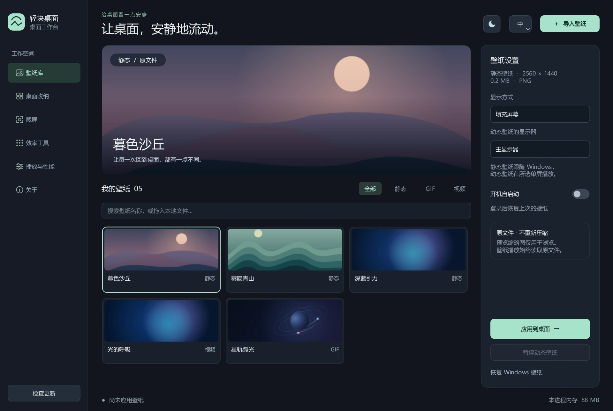
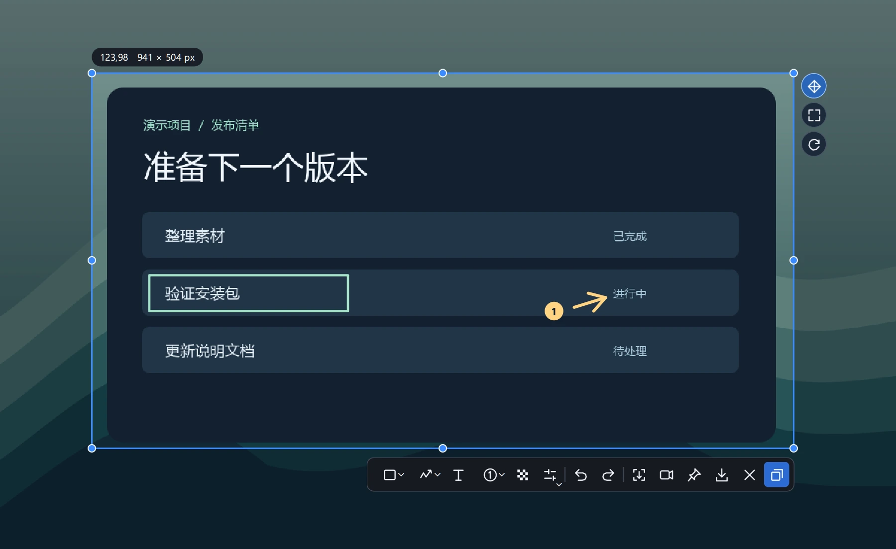
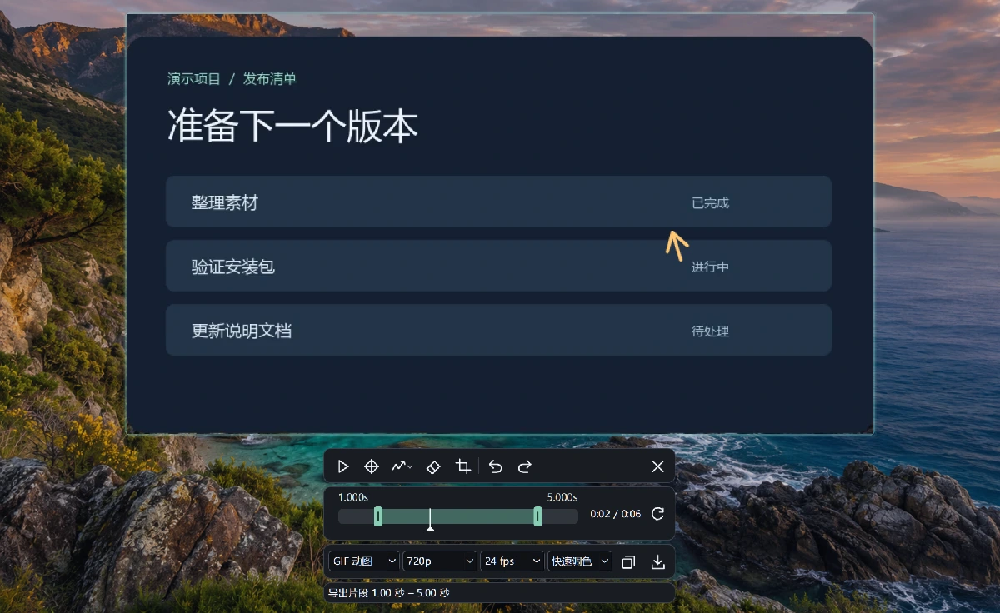
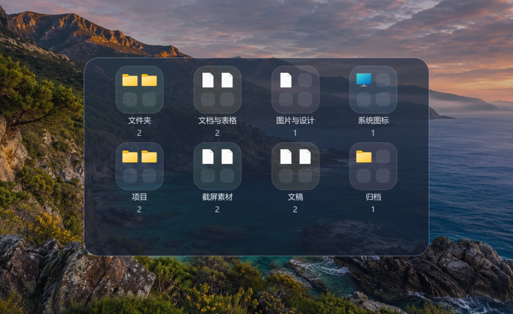
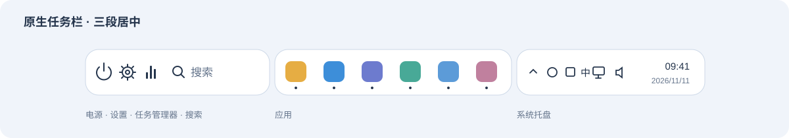
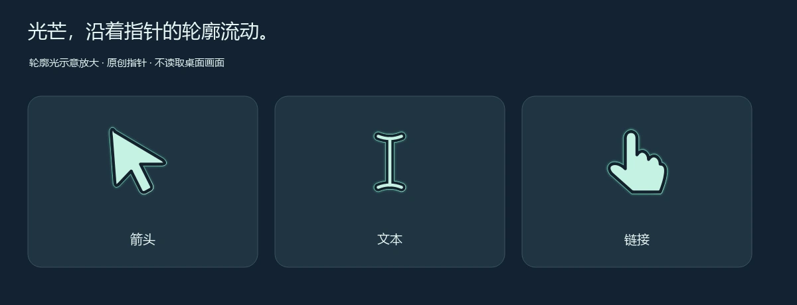
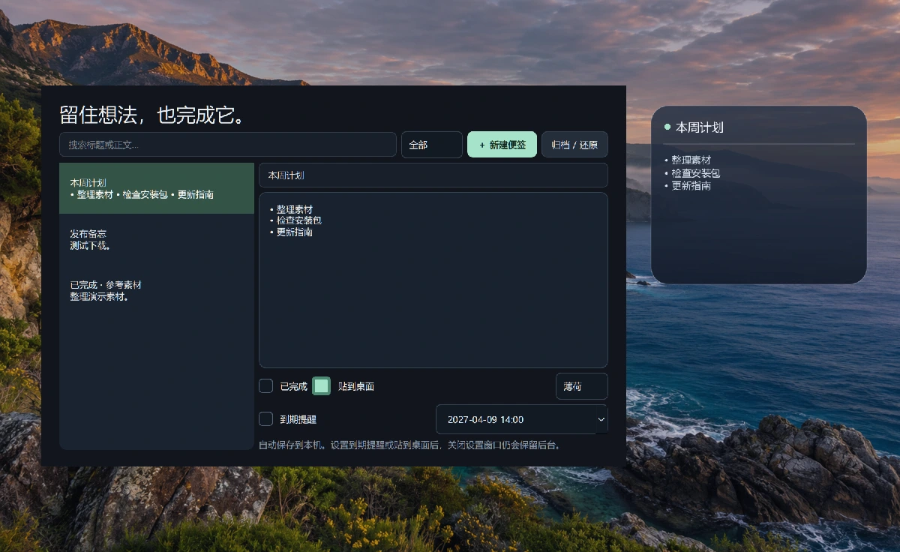
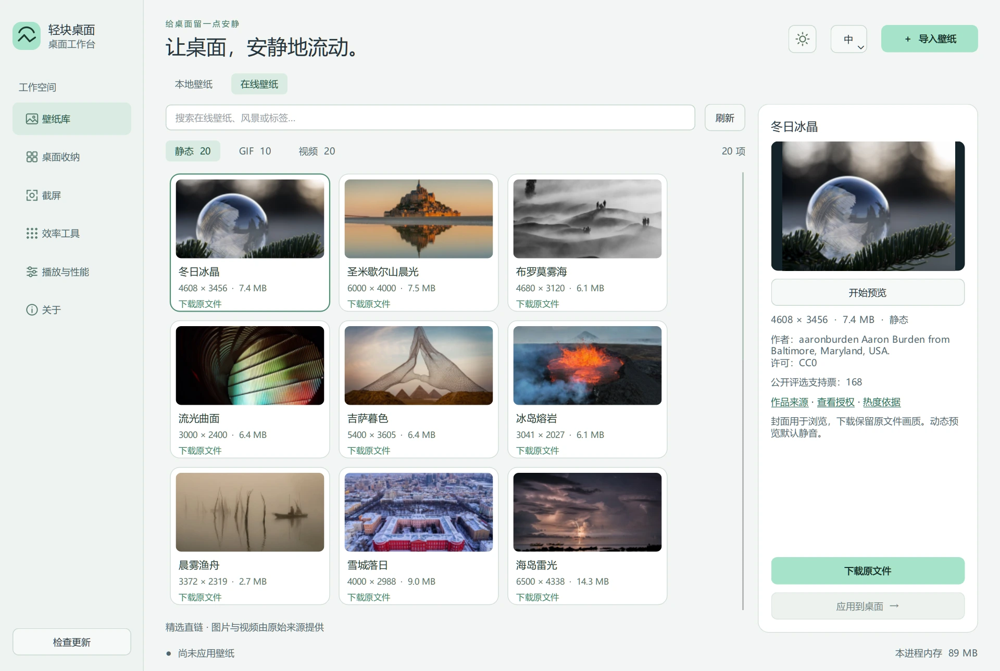

<p align="center"></p>
<h1 align="center">轻块桌面</h1>
<p align="center">Windows 壁纸、截屏录屏、桌面收纳、原生任务栏美化和便签</p>
<p align="center"><a href="https://light-block-desktop.vercel.app/download/?lang=zh"><strong>下载 Windows 安装包</strong></a> · <a href="#功能展示">功能展示</a> · <a href="https://light-block-desktop.vercel.app/?lang=zh">产品官网</a> · <a href="README.en.md">English</a> · <a href="CHANGES.md">更新日志</a></p>


**1.0.0**：三种原创指针、75%～200% 大小、可独立调色的粒子与收纳背景；光芒沿指针外轮廓流动，飘落更细腻。

## 下载与安装

1. 在 [GitHub Releases](https://github.com/GalokPeng/light-block-desktop/releases/latest) 下载 `Setup-x64.exe`。也可完整解压 `Windows-x64.zip` 后运行 `轻块桌面.exe`。
2. 支持 Windows 10 / 11 x64。安装向导自动跟随 Windows 显示语言，支持简体中文、繁体中文和英文。程序在启动时读取同一设置，中文系统显示简体中文，其他语言默认英文。
3. 升级前退出旧版，再启动新版。配置和壁纸库默认保存在安装目录的 `data` 下。旧配置会复制到新目录，安装目录不可写时沿用 `%LOCALAPPDATA%\StillWallpaper`。

Setup 默认安装到当前用户目录。安装版和免安装版均包含壁纸播放、截屏、录屏和媒体导出所需的组件，首次使用即可录屏。录屏组件的许可证和对应源代码见 [第三方声明](THIRD_PARTY_NOTICES.md)。

从 v0.8.0 起，有新版时可点击软件左下角的「立即更新」，在按钮上查看下载进度，再点一次可取消。安装包通过官方 SHA-256 校验后，软件正常退出并启动安装；安装版沿用原目录、保留配置并重新打开，便携版进入安装向导。旧版首次需要手动安装一次以取得更新器。官网提供官方与两条公开加速线路，下载较慢时可以切换。

## 功能展示

### 设置壁纸

导入本地图片、GIF 或视频，保留原画质副本。可选显示器和铺放方式，支持从实际视频帧生成封面。视频每次启动默认静音，开启前确认，改变声音会重新加载视频。动态播放与设置界面隔离，旧播放器退出并取得新首帧后才确认应用。支持登录后恢复壁纸和全屏自动暂停。

自己导入的壁纸可右键删除库内副本，原文件保留。删除正在使用的壁纸时先恢复 Windows 壁纸。在线精选支持预览、搜索、原文件下载与来源署名。内置静态壁纸为「夜驰」「银河」「山海」「海岸」四张 1920×1080 原图，原有动态示例保留。



### 截屏与录屏

默认 `Ctrl+Alt+A` 打开截屏，可选窗口或区域、添加标注、滚动拼接长图、复制 PNG 或原位贴图。录屏可用 `Ctrl+Alt+R` 停止，完成后直接贴屏预览，可涂鸦、裁剪画面和拖动双端时间指针截取片段。点击指针后可用方向键逐帧微调，Shift＋方向键移动十帧。按选定画质与帧率导出 MP4、GIF 或无损 MKV；GIF 提供快速／精细调色。

| 截屏选区与标注 | 录屏预览与导出 |
| --- | --- |
| [](site/public/media/capture-zh.webp) | [](site/public/media/recording-zh.webp) |

### 桌面收纳与原生任务栏美化

收纳支持居上、居中和居下，可按名称、修改时间或分组排列，并搜索桌面项目。新增桌面文件先显示为图标，默认一分钟后自动收纳，可关闭该选项，或右键放入指定分组。收纳、任务栏、分组管理按折叠区展示。图标底板和整体收纳背景支持独立调色、一键恢复默认；分组颜色单独保留，浅色背景自动适配深色文字。关闭收纳会恢复原生图标显示状态。



可选的任务栏美化在 Windows 11 22H2 或更新版本的 x64 主屏上，将电源／设置／任务管理器／原生搜索、应用、系统托盘分三段居中。保留 Windows 搜索和托盘菜单，支持智能隐藏与触底唤出，可调整背景颜色与不透明度。



*原生任务栏三段式布局示意*

### 鼠标与美化

在「美化 → 鼠标与指针」选择流线、棱镜或像素，分别设置颜色和大小。点点／飘落／光芒可与任意指针组合、独立调色。光芒读取当前原生指针的轮廓，仅在外缘显示流光；飘落使用更细小的荧光微粒和柔和淡入淡出。停止移动后停绘，关闭后卸载监听，退出恢复系统方案。



[查看美化设置界面](site/public/media/appearance-zh-light.webp)

### 桌面便签

右键桌面空白处即可新建并贴出便签。Windows 11 从「显示更多选项」进入。便签可拖动、双击标题编辑、拖动边缘改变大小；长正文可滚轮浏览且不显示滚动条，支持自选颜色、搜索、到期提醒、完成标记和归档。



演示截图使用内置素材和虚构数据。设置和下载的壁纸保存在本机，无账户、广告或遥测。在线图库按需访问素材来源。「美化」提供流线、棱镜、像素三种原创指针，支持独立调色、75%～200% 大小；点点、飘落、光芒三种粒子可自由搭配并单独调色，静止后停绘。「设置」保留 Windows 夜间模式入口。更多功能包括快速启动、剪贴板历史、文件工作台和专注计时。[完整使用指南](docs/usage.zh-CN.md)

「本地壁纸 / 在线壁纸」支持切换：静态 20 张、GIF 10 款、视频 20 段，仅按媒体类型筛选。10 款 GIF 按维护者确认保留，与本地复看版一致。所有来源文件至少 1920 × 1080，单项不超过 20 MB；GIF 要求原始 1080p、16:9 的完整循环场景。GIF 不以点赞／收藏作为门槛，公开热度如实记录；静图、视频继续参考公开支持票或收藏筛选。沿用来源文件，不自行压缩、裁短或放大。支持中英文搜索、按需预览、下载进度与取消、已下载状态及应用。GitHub 只保存 URL 和授权目录。关闭设置时正式下载继续，退出软件会取消未完成下载。[评估与筛选记录](docs/wallpaper-evaluation.md)



## 开发与发布

```powershell
python -m pip install -r requirements.txt
python main.py
python tools/run_tests.py
```

Windows x64，Python 3.11 和 PySide6。修改之前可把 [二开 Skill](skills/light-block-desktop-dev/SKILL.md) 交给 Agent。上游 PR 遵循 [贡献指南](CONTRIBUTING.md)，安装包构建和自动发布见 [发布手册](docs/release.md)，官网配置见 [部署说明](docs/website.md)。

应用源码采用 [MIT](LICENSE)。随包运行库保留各自的 [第三方许可证](THIRD_PARTY_NOTICES.md)。

## Star 趋势

[](https://github.com/GalokPeng/light-block-desktop/stargazers)

[](https://www.star-history.com/#GalokPeng/light-block-desktop&Date)

# 致谢与交流

[Wikimedia Commons](https://commons.wikimedia.org/) — 在线壁纸的原始媒体与预览来源。作品版权归各原作者，分别依照其公开许可使用；软件详情与下载记录保留作者、来源及许可。[逐项素材署名](docs/wallpaper-sources.md)

[Internet Archive](https://archive.org/) · [Jeffrey Beach / Beachfront Productions](https://beachfrontprod.blogspot.com/) — 原作者公开提供的 CC BY 3.0 高清视频、预览及浏览与收藏记录，软件保留来源和署名。

[NASA](https://www.nasa.gov/) — 部分 GIF 的原始科学影像来源；具体作品的公有领域或开放许可见逐项署名。

[Linux Do](https://linux.do/)
