# C++ 界面实现与本地对照

> **本地迁移实验归档（2026-11-13，独立测试阶段）。** 文内的“本轮”“当前”、版本号、独立产品名、相邻 Python 目录、截图和 `.local` 路径均指当时的实验工作区，不是本次测试预发布状态或验收证明；正式 Python 1.0.0 继续保留 main，测试版本不替代正式渠道。原 Python v1.0.0 已保留在 [`python-v1.0.0`](https://github.com/GalokPeng/light-block-desktop/tree/python-v1.0.0) 分支及 `v1.0.0` 标签。当前构建／发行要求见[发布手册](../release.md)，用户数据迁移见[使用指南](../usage.zh-CN.md#升级与数据目录)。这里保留原始证据及当时未验证的差异，不宣称逐像素等价。

主窗口、桌面便签、工具页面与截屏录屏工具栏使用 C++ Qt Widgets，桌面、任务栏、媒体监督与截屏引擎仍为原生 C++。运行不需要 Python。壁纸预览、设置、便签管理、剪贴板、文件工作台和专注工作区均在主窗口内；快速启动、桌面便签及截图/录屏贴图保留其需要的独立浮层。

本轮依据 Python v1.0.0 的布局与交互重新实现，并逐项验证已覆盖行为；不是所有功能、像素和系统环境都已完全等价。原 Python 项目保持独立，本版本仅本地构建和测试，未发布。

## 构建

运行 `./build.ps1` 会准备固定版本 Qt 6.8.3 / GCC 13.1 SDK，并分别构建界面 DLL 和 LLVM-MinGW C++23 后端。已缓存 SDK 时可用 `-Offline`。`tools/setup_ui_sdk.ps1` 中记录官方下载地址和 SHA256；不更改系统 PATH、不安装系统级 Qt。

两个编译器的 C++ 标准库 ABI 不相同，主边界通过 `src/ui_api.h` 的 **ABI 3** POD 结构体和函数指针，禁止传递 STL、Qt 对象、异常或跨运行库释放内存。`extension(1..4)` 分别提供文件、剪贴板、专注、快速启动服务；截屏/录屏工具栏另有独立的版本化 POD 导出。接口对应关系见 [架构说明](architecture.md)。

`ui-current.txt` 指向当前哈希命名 DLL。默认工具页面不再嵌入旧 Win32 控件；旧代码仅保留作 legacy 回退。缺少 Qt 依赖时明确报错，只有显式 `--legacy-ui` 才进入旧原生主界面。预览区域使用原生媒体子窗口承载视频，不另弹出壁纸预览窗口。

## 本轮界面与交互

| 范围 | 已实现的界面与行为 |
| --- | --- |
| 本地/在线壁纸 | 页面内预览；在线封面网格、GIF/静图/视频筛选、搜索、来源与授权信息、下载进度及已下载状态；后台封面读取和解码有资源上限 |
| 截屏 | 原版风格的图标主栏、按工具切换的参数子栏和选区侧栏；形状、线条、文字、序号、马赛克及撤销/重做；字体和样式选项只可选择，画布内编辑文字 |
| 录屏/媒体工作室 | 录制状态条、结束后的原位预览；打开已有媒体使用同一编辑流程；双端时间轴、逐帧键盘调整、画面裁剪与标注；MP4/GIF/无损 MKV、尺寸/帧率和 GIF 调色板选项；导出进度与取消 |
| 指针与分组 | 三种指针样式卡片和实际素材预览；指针尺寸、指针/粒子独立配色及粒子选项；分组名称和颜色编辑 |
| 剪贴板 | 历史列表与页面内文字/图片预览，搜索、复制、固定、删除和图片贴图入口 |
| 文件工作台 | 页面内图片/文本/文件夹预览、属性与 SHA-256；后台读取；批量改名前预览，应用、撤销与恢复保留原生事务校验 |
| 专注工作区 | 专注/休息计时、累计记录、壁纸暂停选项及工作区保存/应用/移除 |
| 快速启动 | 无边框搜索面板，应用图标与原版工具入口；多关键词匹配、前缀优先、最多 16 个匹配项，另可显示计算结果；方向键、Enter、Esc |
| 便签管理 | 页面内搜索、正文编辑、完成/归档/提醒、桌面固定与颜色选项；与桌面便签共享正文 |

录屏时间轴的方向键移动一帧，Shift 加方向键移动十帧。GIF 快速/精确选项只改变调色板分析方法，不联动修改输出尺寸与帧率。导入的源文件保持不变；不兼容原生播放器的素材可以生成兼容预览副本。普通屏幕录制仍为静音，导入媒体的 MP4/MKV 导出可保留音轨。

## 状态与生命周期

- 设置每次提交一个字段，基于最新实时配置合并；写入失败恢复原值。滑块使用 180 ms 防抖，切页/关闭时提交待保存值。
- 收纳、任务栏、指针区分当前期望与正在退出的旧会话。旧回调不能取消用户最新的开启操作。
- 本地和在线预览共用独立预览通道，桌面播放使用另一通道。切换页面会停止预览并恢复播放入口；迟到的图片解码结果按代次丢弃。
- 主窗口关闭时释放页面，桌面功能继续运行。Qt 工具页面通过服务会话和请求序号核对异步结果，迟到结果不写入新选择或重建页面。
- 文件变更事务独立于页面寿命；预览可以取消，但关闭页面不能丢弃已开始的文件变更日志与收尾。剪贴板预览解码和快速启动图标读取在后台执行，面板隐藏后停止不必要的 UI 刷新。
- 截屏/录屏工具栏共用图标和样式。窗口位置或可见性未改变时不重复设置顶层几何；回调与销毁分离，减少菜单焦点被抢和关闭时访问已销毁对象的机会。
- 桌面便签和管理页共享正文文档。新建时可直接编辑，失去焦点后返回桌面层；边缘八向缩放，长正文滚动且不显示滚动条。正文有 1 MiB UTF-8 上限，失败保留编辑内容，不截断覆盖文件。

## 验证方式

`./tools/test.ps1` 在独立临时配置中运行后端与真实 C++ Qt 界面测试，生成主页面、16 帧滚动位置、明暗/英文、各工具预览以及截屏录屏参数栏的截图。便签检查包括缩放、滚动、共享正文、管理页交互、保存失败和容量边界；媒体检查包含真实编码、逐帧裁剪、两种 GIF 调色板、无损 MKV 和导入音轨保持。

本轮通过的联合测试：`.local/test-20261113-215830/summary.json`。

| 检查 | 本轮结果 |
| --- | --- |
| 原生回归 | 68 通过，0 失败 |
| C++ Qt 界面 | 截屏、录屏、在线预览、指针卡片、剪贴板、文件、专注、快速启动与便签检查通过 |
| 实际媒体播放 | 静图、GIF、MP4 均进入可用状态，GIF/视频帧推进 |
| 播放切换 | 12 次确认切换，0 失败；预览/桌面通道独立，结束后没有残留播放子进程 |
| 退出与数据隔离 | 父进程退出清理通过；原始 JPEG 校验值记录保留；不安装、不接管真实桌面、不读取原版配置 |

`tools/render_python_reference.py` 仅是开发期的只读参考工具，加载相邻 Python v1.0.0 源码并使用全新独立配置、关闭全局功能，不进入发行运行时。加载本机微软雅黑字体，避免离屏渲染中文字形缺失。

测试截图使用合成素材和独立数据，不能据此断言真实鼠标拖动、持续滚动无闪烁、所有媒体编解码、任务栏接管或多屏/DPI 表现都已验收。尤其媒体工作室的兼容预览回退不等于全格式硬件加速。具体差异和未验收项保留在 [迁移账本](MIGRATION.md)。

## 本地截图

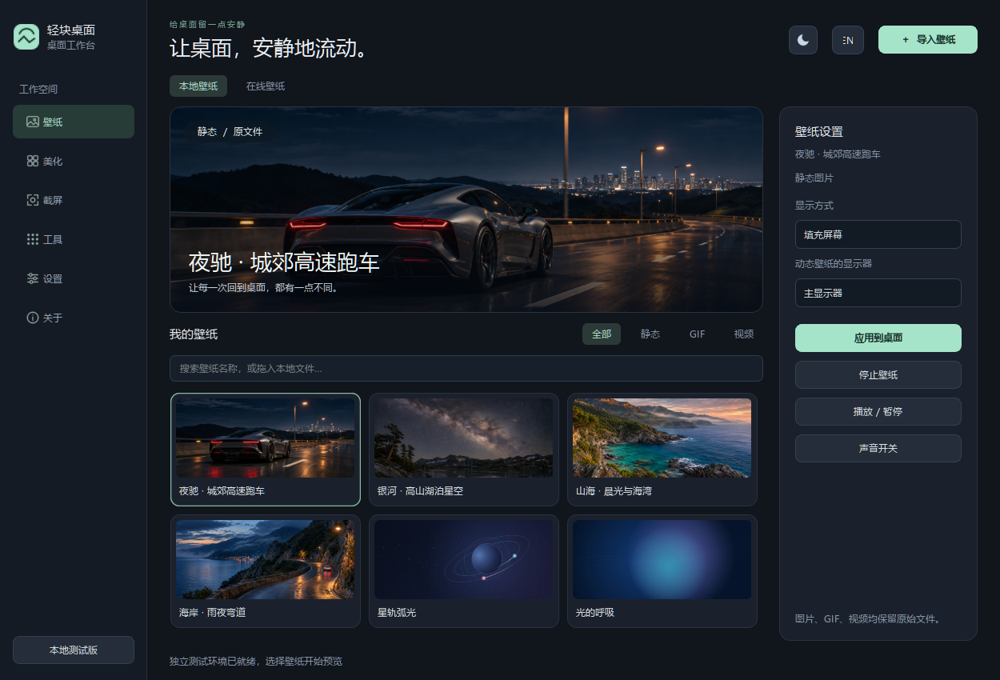
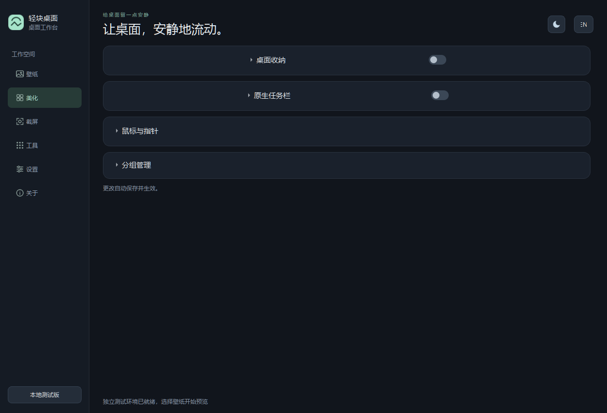
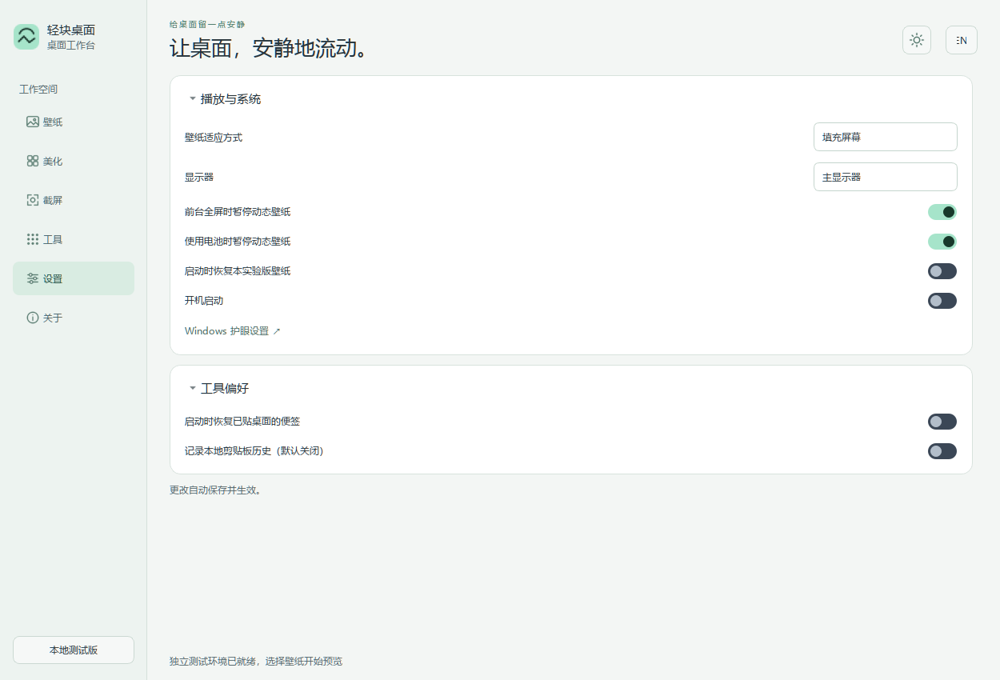
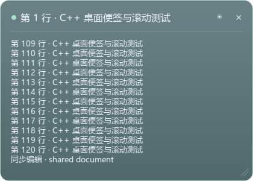
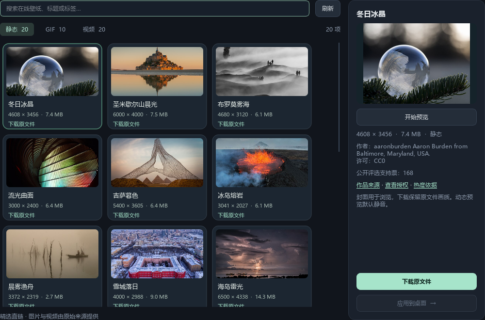
指针卡片的独立实验截图未随本次历史材料归档；上方美化设置图仅展示当时已保存的界面。
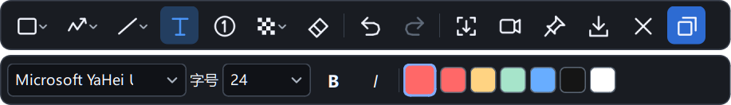
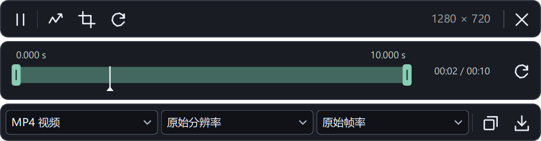
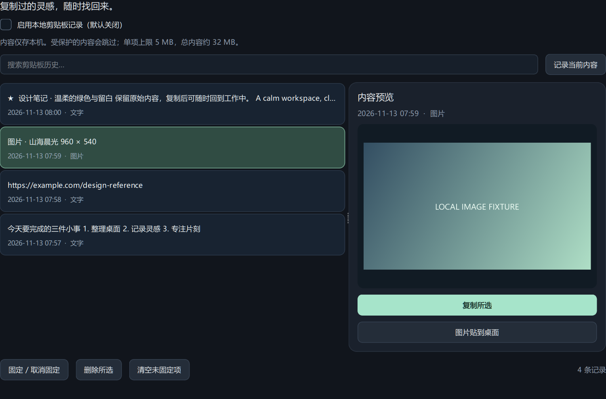
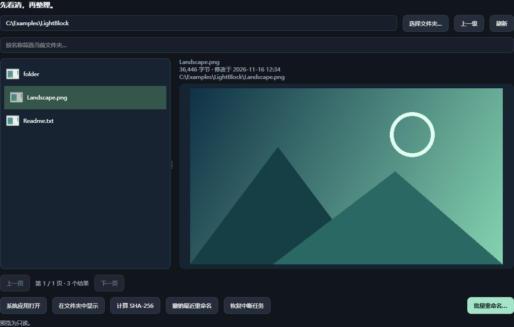
文件工作台图于2026-11-16重新渲染，使用合成文件及虚构的`C:\Examples\LightBlock`展示路径；不包含维护者本机目录。
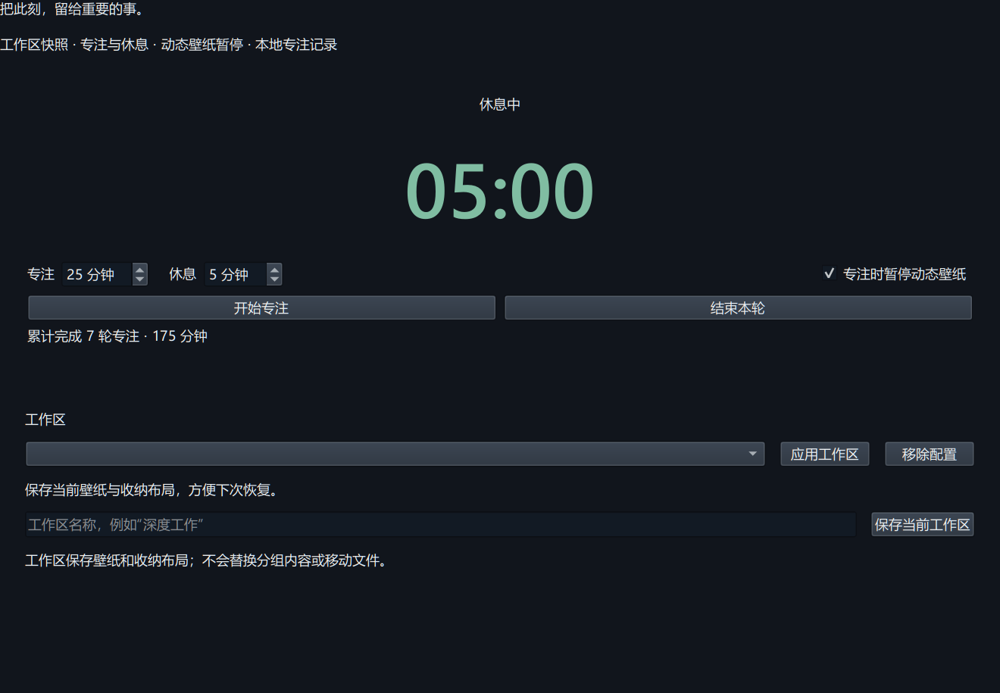
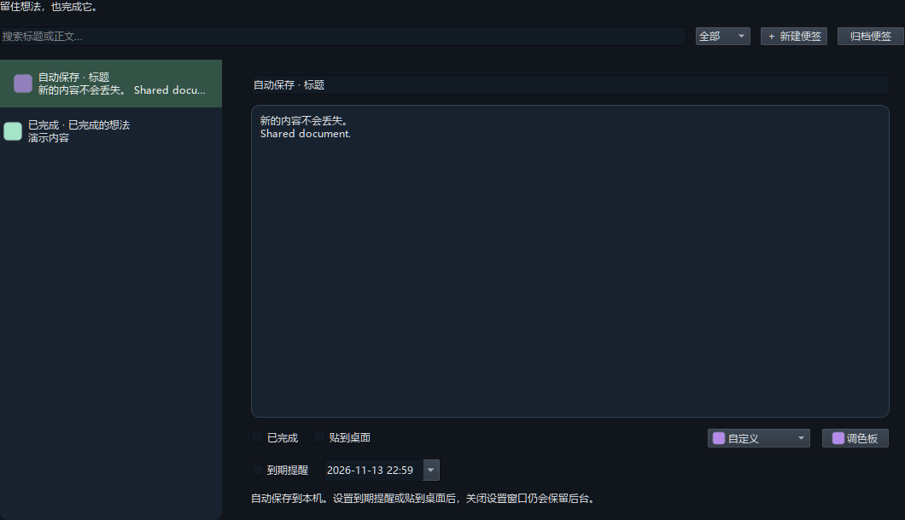
